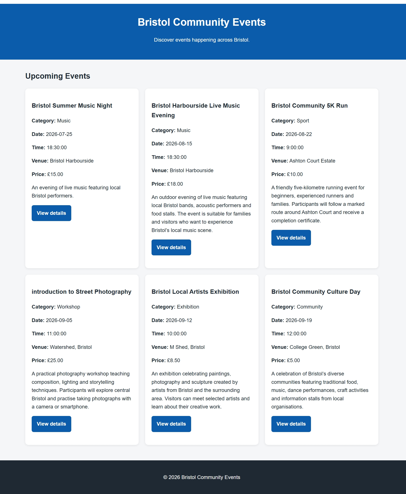
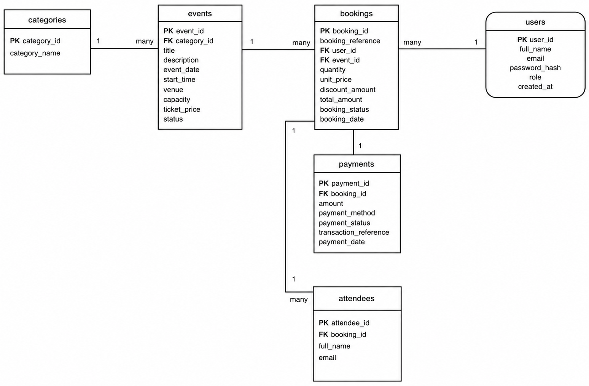
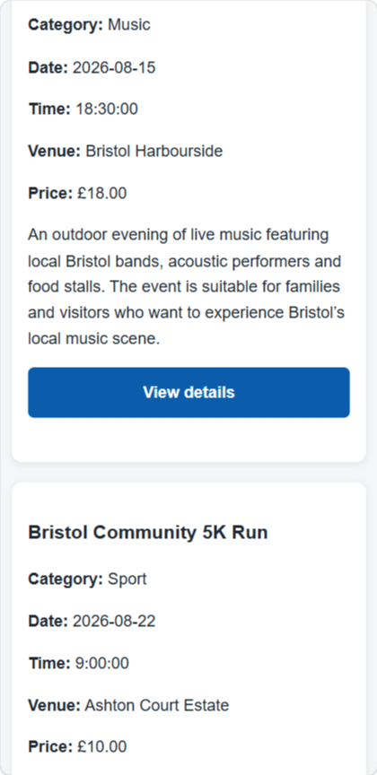
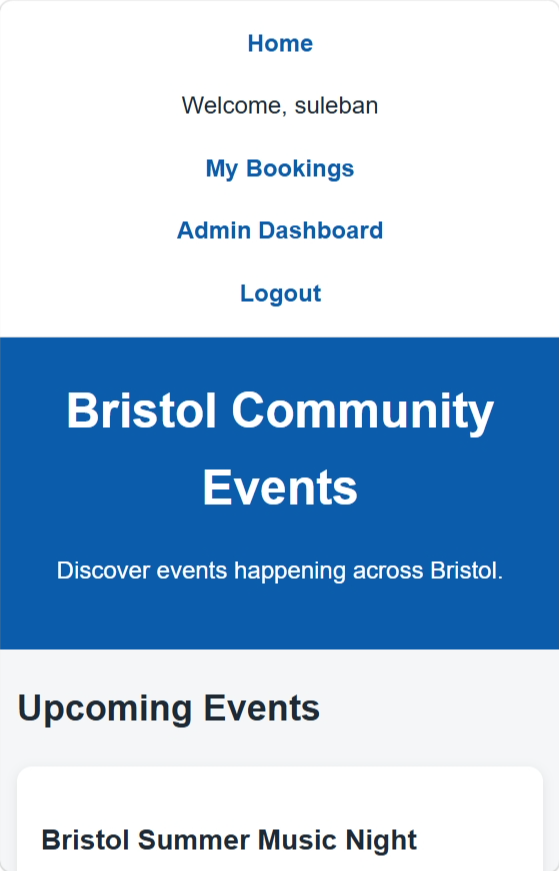

# Bristol Community Events

A full-stack event booking web application built with **Python (Flask)** and **MySQL**. Members of the public can browse local Bristol events, create an account and book tickets. Administrators manage events and view bookings from a protected dashboard.



## Features

**For users**
- Register, log in and log out, with passwords hashed using Werkzeug (scrypt)
- Browse upcoming events by category, date, venue and price
- See live remaining capacity for each event
- Book one or more tickets, with a simulated payment step
- Get a unique booking reference and a printable confirmation
- View all previous bookings

**For administrators**
- Role-protected admin dashboard showing total events, bookings, tickets sold and revenue
- Create, edit and cancel events
- View bookings and attendee details for each event

## Security

- **SQL injection protection:** every database query uses parameterised statements, never string concatenation.
- **Password storage:** passwords are salted and hashed with scrypt through `werkzeug.security`, and never stored in plain text.
- **Access control:** a custom `@admin_required` decorator protects admin routes. Non-admins get a `403 Forbidden` page.
- **Data isolation:** booking confirmation pages check that the booking belongs to the logged-in user, so users can't view other people's bookings by changing the URL.
- **No secrets in code:** the session secret key and database credentials are read from environment variables.
- **Transactions:** a booking, its attendee and its payment are written in one transaction and rolled back together if any step fails.

## Tech stack

| Layer | Technology |
|---|---|
| Backend | Python 3, Flask 3, Jinja2 templates |
| Database | MySQL / MariaDB (`mysql-connector-python`) |
| Frontend | HTML5, CSS3 (responsive, no framework) |
| Security | Werkzeug password hashing, session-based auth |

## Database design

Six related tables: `users`, `categories`, `events`, `bookings`, `attendees` and `payments`.



The editable diagram is in [`docs/erd.drawio`](docs/erd.drawio).

## Responsive design

The layout adapts from a three-column grid on desktop to a single column on mobile.

| Tablet | Mobile |
|---|---|
|  |  |

## Running it locally

**Requirements:** Python 3 and a MySQL or MariaDB server (for example, XAMPP).

1. **Create the database.** Create a database called `bce_resit` and import [`database/schema.sql`](database/schema.sql). In phpMyAdmin, use Import; on the command line, run `mysql -u root bce_resit < database/schema.sql`.

2. **Install the dependencies:**
   ```bash
   python -m venv venv
   # Windows:      venv\Scripts\activate
   # macOS/Linux:  source venv/bin/activate
   pip install -r requirements.txt
   ```

3. **Configure it (optional).** The defaults match a local XAMPP install (`root` user, no password). To use other settings, set any of these environment variables: `SECRET_KEY`, `DB_HOST`, `DB_USER`, `DB_PASSWORD`, `DB_NAME`, `FLASK_DEBUG=1`.

4. **Create an admin account:**
   ```bash
   python create_admin.py
   ```

5. **Start the app:**
   ```bash
   python app.py
   ```
   Then open http://127.0.0.1:5000.

Normal user accounts can be created through the Register page.

## Project structure

```
.
├── app.py               # Flask routes, authentication and database logic
├── create_admin.py      # Helper script to create an administrator account
├── requirements.txt
├── database/
│   └── schema.sql       # Tables, keys, constraints and sample events
├── templates/           # Jinja2 HTML templates
├── static/css/          # Stylesheet
└── docs/                # ERD and screenshots
```

## Possible improvements

- Add CSRF tokens to forms (for example, with Flask-WTF)
- Rate-limit login attempts to slow down brute-force attacks
- Connect to a real payment provider's test mode, such as Stripe
- Send booking confirmation emails
- Let users cancel their own bookings and free up capacity

## Background

I originally built this for the Web Development and Databases module at the University of the West of England (UWE), then tidied it up for my portfolio.
